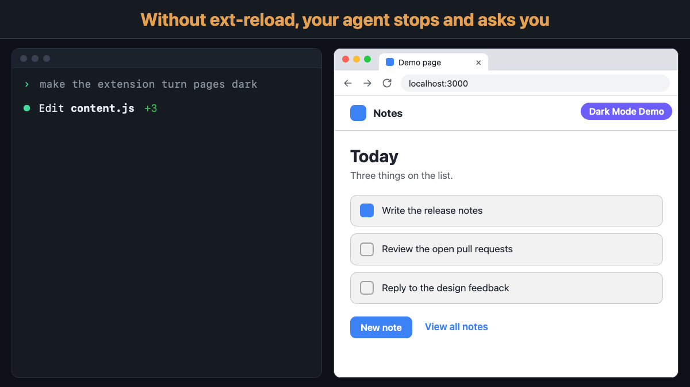

# ext-reload

Your coding agent edits your Chrome extension, then stops and asks you to press Reload at `chrome://extensions`.
It has no other way: browser automation cannot touch that page, and an unpacked extension keeps running its old
code until something reloads it.



ext-reload is a command-line tool and a small helper extension. One command reloads the unpacked extension in
the current folder, in the Chrome you already have open, then reloads the tabs its content scripts run on. It
takes about a quarter of a second and works for anything that can run a shell command: Claude Code, Codex,
Cursor, or you in a terminal. It was built with Claude Code.

    ~/ext-reload/ext-reload.mjs              # the extension in this folder or the nearest parent
    ~/ext-reload/ext-reload.mjs <folder>     # or name the folder
    ~/ext-reload/ext-reload.mjs --ping       # is the helper answering, and what does Chrome have loaded?

A typical run:

    Reloaded Watch Later Tidy for YouTube™ 2.5.0: service worker and content scripts read again from disk.
    Reloaded 1 tab(s):
      Watch later - YouTube | https://www.youtube.com/playlist?list=WL

## Requirements

- **Node.js 16 or newer** for the CLI. It uses only Node's standard library, so there is nothing to install.
- **Node.js 20 or newer** to run the tests, because Playwright 1.64 needs it.
- **git**, which you install it with, also runs the daily update check and `--update`.
- **Chrome 110 or newer.** The helper keeps its service worker awake with an API call every 20 s, which resets
  the worker's idle timer only from Chrome 110.
- **Developer mode on** at `chrome://extensions`. Load unpacked needs it anyway. Leave it on: from Chromium
  156, an unpacked extension that reloads while it is off comes back turned off.

### Platforms

Before sending a request, the CLI checks that Chrome is running, so a closed Chrome fails at once instead of
after a 35 s wait.

| Platform | Status | Chrome check |
|---|---|---|
| macOS | Tested: Chrome 155, and Playwright's Chromium 156 for the test suite | A process named `Google Chrome` |
| Linux | Not tested | A process named `chrome`, `chromium` or `chromium-browse` |
| Windows | Not tested | `tasklist` lists `chrome.exe`. Run the CLI as `node ext-reload.mjs` |

Where the check cannot tell (another platform, or no `pgrep`), it is skipped, and a closed Chrome shows up as
exit 4 after the 35 s wait. Chrome Beta, Canary, Chromium on macOS, and other Chromium-based browsers run under
other process names: set `EXT_RELOAD_SKIP_CHROME_CHECK=1` to skip the check for them. Those browsers are
untested.

## Install

Once per machine and per Chrome profile. Pick one way.

### Option 1: Prompt your coding agent

Paste this into Claude Code, Codex, Cursor, or any agent that can run shell commands. It does everything except
loading the helper into Chrome, which Chrome keeps for you; the agent tells you the three clicks.

```text
Install ext-reload (https://github.com/dominic-lam/ext-reload) so you can reload my unpacked Chrome extension
yourself, and use it from now on.
1. If ~/ext-reload does not exist, run: git clone https://github.com/dominic-lam/ext-reload.git ~/ext-reload
2. Run ~/ext-reload/ext-reload.mjs --ping.
3. If it exits 4, Chrome is closed or the helper is not loaded. Tell me exactly this, then wait: open
   chrome://extensions, turn on Developer mode, click Load unpacked, pick ~/ext-reload/extension.
   Then run --ping again.
4. Once --ping lists my extensions, copy the "Reloading the extension" block from ~/ext-reload/README.md into
   this project's agent instructions file (AGENTS.md, CLAUDE.md, or whichever file you read), and follow it.
```

### Option 2: Install it yourself

1. Clone it. Any folder works; the examples here use `~/ext-reload`.

       git clone https://github.com/dominic-lam/ext-reload.git ~/ext-reload

2. Open `chrome://extensions`, turn on **Developer mode**, click **Load unpacked**, and pick
   `~/ext-reload/extension`.
3. Run `~/ext-reload/ext-reload.mjs --ping`. It lists the unpacked extensions Chrome has.
4. Add the instruction below to your project's agent instructions file (`AGENTS.md`, `CLAUDE.md`, or whichever
   file your agent reads).

Keep the helper loaded from your clone: Chrome reads the helper's files from wherever it was loaded, and the
CLI writes its requests into the `extension/inbox/` folder next to itself. The helper's id is
`aedmcelajgmppcepfnehdcnpolaeoajp` wherever it lives, fixed by the `key` in `extension/manifest.json`.
Clicking the helper's toolbar icon shows what it is and whether an update is out; there is nothing to set.

## The instruction for your agent

Option 1 adds this for you. Swap the path if you cloned somewhere other than `~/ext-reload`; the CLI finds its
inbox relative to itself.

```markdown
## Reloading the extension

After editing any file of the extension, run `~/ext-reload/ext-reload.mjs` from its folder before testing or
asking me to look. Never ask me to press Reload at chrome://extensions. Act on the exit code:

- 0: reloaded, along with the tabs its content scripts run on. Carry on.
- 1: read the message and fix the cause.
- 2: Chrome runs this extension from another folder (usually the main checkout while you work in a worktree).
  Tell me the folder it names; do not reload that one instead.
- 3: manifest.json changed, which this reload cannot pick up. Ask me to press Reload on the extension's card at
  chrome://extensions once, or offer to add the dev-only hook from the ext-reload README so it can.
- 4: Chrome is not running or the helper is not loaded. Tell me, and point me to the install steps in the
  ext-reload README.

Tabs playing sound are skipped on purpose and named in the output; do not reload them yourself.
If ext-reload prints an update notice, tell me; run it with `--update` only when I say so.
```

## What a reload covers

| Edited | Picked up |
|---|---|
| Service worker, content scripts, popup, options and other pages, CSS | Yes |
| `manifest.json` (a new content-script file, permissions, version) | Only with the dev hook below; otherwise exit 3 |

Without the hook the helper turns the extension off and on (`chrome.management.setEnabled`). Chrome then reads
the code again but keeps the manifest it already had: measured 2026-10-14, a changed version and name stayed
old while the new service worker and content script ran. Missing a manifest edit silently would mean testing
code that is not loaded, so the CLI compares `manifest.json`'s modification time with the last time Chrome
read it (browser start, or a full reload the helper saw) and exits 3 when the file is newer.

Right after the helper is installed it has seen no load yet, and says "Not checked" instead, until Chrome
restarts or the extension gets a full reload.

## Tabs

By default, every tab in a normal window matching the extension's `content_scripts` patterns. A tab whose old
content script lost its extension is broken until it reloads, so this is what you would do by hand.

- A tab playing sound is left alone, and named, so your music or video never stops.
- App windows (the YouTube Music app matches `*.youtube.com`) are left alone.
- Patterns for every site (`<all_urls>`, `*://*/*`) are left out; pass `--tabs` to choose.
- `--tabs <pattern>` replaces the list (repeatable); `--no-tabs` reloads none.

## Exit codes

| Code | Meaning | What to do |
|---|---|---|
| 0 | Reloaded | Carry on |
| 1 | The reload failed, or bad arguments | Read the message |
| 2 | Chrome has no unpacked extension from this folder | Usually a worktree while Chrome runs the main checkout; the message names the folder Chrome has |
| 3 | `manifest.json` changed after Chrome last read it | The Reload button on the extension's card, or add the dev hook |
| 4 | Chrome is not running, or the helper did not answer within 35 s | Start Chrome, or see Install |

`--check-update` and `--update` use only 0 and 1: 1 means it could not check, or did not update, and the
message says why. A helper that could not be reloaded after an update is reported with exit 0, because the
update itself worked.

## Updates

Once a day, ext-reload checks whether your clone is behind. The only thing it contacts is your clone's own git
remote, with `git fetch` (the current branch's upstream, else `origin/main`): no GitHub API, nothing else. The
check runs in a detached background process after a command has finished, so no command waits for it. A fetch
that fails, offline for instance, is noted and never printed.

When a newer version is out, every run adds one line to stderr:

    ext-reload 1.6.0 is available (you have 1.5.0). Run ext-reload.mjs --update.

Stdout and the exit codes stay as they were. Commits that leave the version alone (docs, tests) bring no notice.

- `--check-update` checks now and says which: up to date, an update is available, or it could not check, and
  why (exit 1).
- `--update` pulls, fast-forward only. It refuses, with exit 1, while tracked files have uncommitted changes or
  your clone has commits the remote does not. When the helper's files changed, it reloads the helper the way
  `--self` does. If the helper does not answer, it says a reload is still needed, and the update stands.
- The helper's popup shows the same answer: "Up to date · v1.5.0", "Update available", or "not checked yet".
- `EXT_RELOAD_NO_UPDATE_CHECK=1` turns off the daily check and the notice. `--check-update` and `--update` still
  work when you run them.

The answer lives in `extension/update.json`, which the CLI writes and the popup reads; the helper itself never
goes online. Like `extension/inbox/`, it is not tracked by git. A copy that is not a git clone, such as a
downloaded zip, skips the check.

Versions before 1.5.0 have no `--update`. Update those once by hand:

    git -C ~/ext-reload pull --ff-only && ~/ext-reload/ext-reload.mjs --self

## The dev hook: full reloads, manifest included

An extension can offer to reload itself. Before toggling, the helper asks it with
`chrome.runtime.sendMessage(id, { type: 'ext-reload' })`; one that answers `{ ok: true }` and calls
`chrome.runtime.reload()` gets the same reload as the button: manifest re-read, `onInstalled` fired with
reason `update`. One without the listener refuses in a few milliseconds and gets the toggle.

```js
// Dev builds only: lets ext-reload do a full reload, manifest included.
chrome.runtime.onMessageExternal.addListener((msg, sender, reply) => {
  if (sender.id !== 'aedmcelajgmppcepfnehdcnpolaeoajp' || msg?.type !== 'ext-reload') return;
  reply({ ok: true });
  setTimeout(() => chrome.runtime.reload(), 50);
});
```

Gate it behind your own dev-build flag, so store builds never carry it. It works only while the extension has
no `externally_connectable` key, or lists the helper's id in its `ids`. The id is fixed by the `key` in
`extension/manifest.json`.

## How it works

The CLI writes `extension/inbox/request.json` (a temp file renamed into place, so never read half-written)
holding the request, a nonce, an expiry and a port it listens on at 127.0.0.1. The helper's service worker
reads that file every 250 ms: an unpacked extension's own files are read fresh from disk, no reload needed.
On a new nonce it POSTs "received" to the port, does the work, and POSTs the result. The inbox folder is
created on first use and is not tracked by git.

- **Staying awake:** an extension API call every 20 s resets the worker's idle timer (Chrome 110+); an alarm
  every 30 s restarts a worker Chrome stopped anyway. The CLI waits up to 35 s for "received" for that reason.
- **No repeat after `--self`:** the last nonce handled lives in `storage.local`, so a helper that just
  reloaded itself does not act on the same request again.
- **Why not native messaging:** it needs a host program that Chrome starts on its own, registered outside the
  repo on each machine (a manifest file in a Chrome-specific folder, or a registry key on Windows). Reading a
  file inside the helper's own folder needs no install step: clone, Load unpacked, done.

## Why not Chrome DevTools MCP

Google's `chrome-devtools-mcp` has a `reload_extension` tool (`--categoryExtensions`). Checked 2026-10-14 with
version 1.10.1 on Chrome 155. It is not a replacement:

- **It deletes the extension at the next Chrome restart.** It reloads by reinstalling over CDP, which sets
  `INSTALLED_VIA_CDP` (`creation_flags` 38 → 32806) on an extension that was loaded by hand, and Chrome removes
  such extensions at startup. `chrome.storage` survives, and the next load fires `install`.
- **It leaves matching tabs orphaned.** The agent has to list them, match the patterns itself and reload them one
  call at a time. It cannot see whether a tab is playing sound or is an app window.
- **It cannot name the folder Chrome has loaded.** A worktree gets "not found", or a second copy if installed.
- **It is costly to attach to the everyday profile.** `--autoConnect` shows an Allow dialog on every connection
  and the automation banner while connected. The tool schemas take about 7k tokens of context, or 3.5k trimmed.

What it does better: manifest edits are picked up (name, version, new content scripts; `onInstalled` fires
`update`) with no dev hook. In a browser the server launched itself, nothing gets deleted.

**Recheck** when a release note for chrome-devtools-mcp mentions `reload_extension` or extension installs:

    cd ~/ext-reload/compare/devtools-mcp && npm install && node q5-hand-loaded.mjs

It runs `chrome-devtools-mcp@latest` against a headless branded Chrome on a temporary profile, never your
everyday one. The deletion is fixed when the line after `B: after reload_extension` lists the toy instead of
`[]`. Even then, the tab handling above still favours ext-reload. The script needs Node 22 or newer (it uses
the built-in `WebSocket`) and looks for Chrome at the macOS path in `lib.mjs`; on Linux or Windows, change
`CHROME` there.

## Limits

- One request at a time: two sessions calling at once overwrite each other's request, and one times out.
- One Chrome profile: a helper in two profiles would both act on the same request.
- Chrome only. Firefox has `web-ext run`, which reloads on file changes by itself.

## Testing

    npm install
    npx playwright install chromium
    npm test

End to end in Playwright's own Chromium, on a temporary copy of the CLI and the helper, so a helper in your
everyday Chrome never sees a test request. It covers code edits, the tab reload, the manifest check (exit 3),
the dev hook's full reload, a folder Chrome does not have (exit 2), an id worked out through a symlink,
`--self` restarting exactly once, and a copy with no `extension/inbox/` yet, as in a fresh clone.

`test-update.mjs`, which `npm test` runs next, covers updates against a local bare repo standing in for GitHub,
with no network: a copy that is not a git clone, up to date, the 24-hour gate, a newer version (the notice on
stderr, stdout and exit codes unchanged), the opt-out variable, an unreachable remote, and `--update` refusing
on uncommitted changes or a diverged clone, fast-forwarding, and reloading the helper in Playwright's Chromium.

The test loads extensions over CDP (`Extensions.loadUnpacked`). That differs from the Load unpacked button in
one way: Chrome removes CDP-installed extensions at its next start (see Why not Chrome DevTools MCP). The tests
never restart the browser, so it does not affect them.
Under `--load-extension` an extension that calls `chrome.runtime.reload()` comes back turned off, which no
real Chrome does. It also turns on Developer mode first, for the reason under Requirements.

## License

MIT. See [LICENSE](LICENSE).
